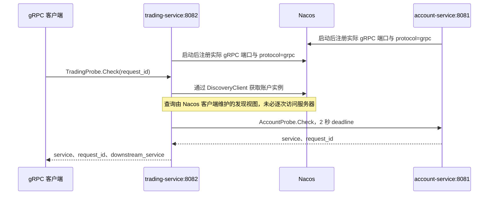

# 架构说明

[返回项目首页](../README.md)

## 模块与职责

| 模块 | 当前职责 | 依赖 |
| --- | --- | --- |
| `ledger-pb` | 定义版本化 Protobuf 协议，生成 Java 消息和 gRPC stub | Protobuf、gRPC |
| `account-service` | 账户服务启动入口、诊断接口、服务自身的中间件配置与 Nacos 注册 | ledger-pb、Spring Boot、Spring Cloud 和中间件客户端 |
| `trading-service` | 交易服务启动入口、账户调用、gRPC 发现客户端及服务自身的基础配置 | ledger-pb、Spring Boot、Spring Cloud 和中间件客户端 |
| `gateway` | Go 动态 HTTP → gRPC 转换、Nacos 发现、路由热更新 | 独立 Go Modules，不参与 Maven 构建 |

服务构建时保留普通 JAR，并生成带 `exec` classifier 的可执行 JAR。运行服务使用 `*-exec.jar`。

`ledger-pb` 是协议依赖库，无需独立部署。两个服务分别声明中间件依赖，`application.yml` 只维护必要启动项和 Nacos 公共参数，按 profile 导入对应的 bootstrap 文件。dev 完整使用本地 `bootstrap-dev.yml`，Nacos 仅用于注册与发现，配置中心和导入检查均关闭。test/prod 先读取 Nacos 的 `ledger-infrastructure.yml`，再读取自己的服务配置，模板在 `config/nacos/`。环境 namespace 默认分别为 `ledger-dev`、`ledger-test`、`ledger-prod`。根 POM 只统一依赖版本与构建约束，基础配置类位于各服务的 `infrastructure.config`。

## 当前调用链

两个服务的 `GrpcVirtualThreadConfiguration` 在 `spring.threads.virtual.enabled=true` 时提供专用虚拟线程执行器，并通过 `GrpcServerExecutorProvider` 接入 gRPC 服务端。每个执行任务使用独立虚拟线程，名称前缀为 `grpc-virtual-`；Spring 关闭上下文时关闭执行器。关闭该开关后恢复 gRPC 默认执行器。该配置控制 RPC 服务回调，Netty 网络 I/O 仍使用事件循环线程。



Java 侧两个服务都使用 `web-application-type: none`。各自的 `GrpcDiscoveryConfiguration` 监听 gRPC 启动事件，通过 `ObjectProvider` 获取 Nacos 注册组件，取得实际监听端口后触发注册；注册组件不存在时跳过处理，不依赖 HTTP WebServer 启动事件。两个服务显式引入 `spring-boot-web-server`，用于提供 Spring Cloud 注册基类引用的事件类型，不会因此启动 HTTP 服务器。Nacos 注册和 MyBatis 插件类都是普通 `@Configuration`，由各服务组件扫描加载，无需自动配置导入清单。

交易服务的 `infrastructure.grpc.DiscoveryGrpcChannels` 每次选择实例时过滤 `protocol=grpc` 元数据，按轮询选择实例，并按地址复用 ManagedChannel。当前不实现自动重试、熔断或失效地址连接的主动淘汰；缓存连接在应用关闭时释放。

## 业务分层与数据归属

新增业务时按以下职责组织包；目前尚未创建的 application/domain 包随业务增加：

```text
com.ledger.account 或 com.ledger.trading
├── interfaces.grpc          # 协议适配、参数转换、gRPC 状态码
├── application              # 用例编排、事务边界
├── domain                   # 业务规则、领域对象、仓储接口
└── infrastructure
    └── persistence
        ├── entity           # MyBatis-Plus 数据库实体
        └── mapper           # @Mapper + BaseMapper
```

账户服务拥有 `account` schema，交易服务拥有 `trading` schema；两者当前共享开发数据库和登录用户。schema 划分是项目约定，当前不是数据库权限隔离。schema 通过根目录 `db/` 中的 SQL 手动创建，服务启动时不自动执行脚本。MyBatis 实体需显式标注所属 schema，业务 SQL 使用完整的 schema.table 名称。服务间访问数据通过 gRPC 或后续业务事件，不直接查询对方表。

## 当前实现边界

已具备基础构建、服务启动、配置中心、服务发现、诊断 RPC、手动数据库初始化脚本、MyBatis-Plus CRUD/分页/乐观锁能力，以及 Redis/Kafka 客户端配置。

目前没有业务表、资金账务、委托状态机、业务消息 topic 或监听器，也没有业务缓存。诊断 `request_id` 只做透传，不是幂等键或完整链路追踪。Go 网关已支持动态 unary 调用、文件/Nacos 配置热更新和可选上游 TLS，详见[网关指南](../gateway/README.md)。完整用户鉴权、资金一致性和业务幂等仍需随业务实现。

## 动态网关的数据流

网关启动时读取独立的 `gateway/config/config.yaml`，配置 HTTP 监听、Nacos、上游 TLS、访问 token 及路由来源，不读取环境变量。Java 和网关均无需 `.env` 文件。可用 `-config` 指定其他启动配置；配置内相对路径以该文件所在目录为基准。服务发现和远端路由共用 YAML 中的 Nacos namespace/group，需与 Java 服务的注册配置对齐。

启动配置在进程启动时加载，修改后需要重启。路由规则统一从 Nacos 订阅，默认 Data ID 为 `gateway-routes.yml`，支持热更新。本地 `config/routes.example.yml` 仅作为发布示例，运行时不读取。

HTTP 请求按已发布路由解析，使用缓存的方法描述构造 dynamicpb 消息，通过复用的 gRPC 连接调用 Java。反射描述只在路由加载阶段读取；Nacos 实例变更独立更新 resolver，不要求重新发布路由。描述文件也可替代反射。

新路由在独立快照中校验，旧请求完成后整体切换并释放旧连接。无效更新保留旧版本。路由配置只允许已声明的服务和方法，外部请求不能自由指定上游地址或方法。当前只支持 unary RPC，不支持流式转换。
