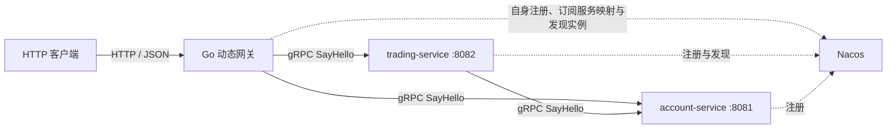

# 架构说明

[返回项目首页](../README.md)

本文描述仓库当前实现。后续领域划分、一致性与运行治理建议见[架构演进路线](roadmap.md)，其中的方案尚未落地。

## 当前架构概览



图中实线表示现有 Hello 请求链，虚线表示注册、发现和网关配置依赖。test/prod 的 Java 服务还从 Nacos 导入运行配置。PostgreSQL 在启动时由 Flyway 执行迁移；Kafka 和 Redis 当前仅接入客户端配置，三者均未参与 Hello 调用链。

Go 网关在服务配置加载完成并开始监听后，以 `ledger-gateway` HTTP 临时实例注册到相同 Nacos namespace/group，退出时先注销再排空 HTTP 请求；可通过 `registration.enabled` 关闭自身注册。注册地址支持配置可达 IP 和映射端口，默认使用实际监听端口。该注册用于实例发现，尚未实现 Prometheus 指标出口。

## 模块与职责

| 模块 | 当前职责 | 依赖 |
| --- | --- | --- |
| `ledger-grpc` | 版本化协议、生成的消息与 stub、共享客户端、发现与连接管理、默认服务端异常处理、条件自动装配 | Protobuf、gRPC、Spring Boot 自动装配、Spring Cloud Commons；optional Spring gRPC Core |
| `account-service` | 账户服务启动入口、服务自身的中间件配置与 Nacos 注册 | ledger-grpc、Spring Boot、Spring Cloud 和中间件客户端 |
| `trading-service` | 交易服务启动入口、使用共享账户客户端、服务自身的基础配置 | ledger-grpc、Spring Boot、Spring Cloud 和中间件客户端 |
| `gateway` | Go 动态 HTTP → gRPC 转换、Nacos 发现、路由热更新 | 独立 Go Modules，不参与 Maven 构建 |

服务构建时保留普通 JAR，并生成带 `exec` classifier 的可执行 JAR。运行服务使用 `*-exec.jar`。

`ledger-grpc` 是共享通信库，无需独立部署；客户端按配置启用，使用方提供 Nacos 等发现实现。两个服务分别声明中间件依赖，服务端注册、虚拟线程与 MyBatis 配置位于各自的 `infrastructure.config`。根 POM 管理依赖版本、JDK/Maven 约束和 Lombok 注解处理。

Java 默认使用 dev 本地配置，test/prod 导入 Nacos 运行配置；Go 网关使用独立启动 YAML。文件职责与发布规则见[配置与运行](configuration.md)。

## 服务端、Stub 与共享客户端

| 类型 | 当前实现 | 职责 |
| --- | --- | --- |
| 服务端 Endpoint | `AccountHelloEndpoint`、`TradingHelloEndpoint` | 继承生成的 `ImplBase`，以 `@GrpcService` 注册并处理 RPC |
| 生成的 Stub | `AccountServiceGrpc`、`TradingServiceGrpc` 中的客户端类型 | 从 `.proto` 生成，描述远程调用方法 |
| 共享客户端 | `AccountGrpcClient`、`TradingGrpcClient` | 使用 Stub 发起调用，统一接入服务发现、连接管理与超时 |

当前每个 protobuf service 对应一个 Endpoint 和一个共享客户端；同一 service 中的多个 RPC 作为类中的多个方法。Endpoint 的业务编排随实际用例抽到 application 层。模块名为 `ledger-grpc`，生成 Java 包仍为 `com.ledger.pb.*`。

账户与交易服务共用 `DefaultGrpcExceptionAdvice`：已有 gRPC 异常保留状态与 trailers，未预期异常记录后返回固定的 `INTERNAL` 响应。该 advice 独立于客户端开关自动装配，使用方提供自定义 `@GrpcAdvice` 时默认实现退出。详细规则见[统一异常处理](../ledger-grpc/README.md#服务端统一异常处理)。

共享请求拦截器负责 `x-request-id` 的校验、生成和回传，使用 gRPC Context 保存请求 ID，并为回调设置、恢复 MDC。Java 共享客户端将同一 ID 传给下游；完成日志记录调用方向、RPC 方法、状态及耗时。默认服务端拦截器位于异常处理器外层，能记录映射后的状态；详见[请求标识与调用日志](../ledger-grpc/README.md#请求标识与调用日志)。

## 服务运行与发现

两个服务的 `GrpcVirtualThreadConfiguration` 在 `spring.threads.virtual.enabled=true` 时提供专用虚拟线程执行器，并通过 `GrpcServerExecutorProvider` 接入 gRPC 服务端。每个执行任务使用独立虚拟线程，名称前缀为 `grpc-virtual-`；Spring 关闭上下文时关闭执行器。关闭该开关后恢复 gRPC 默认执行器。该配置控制 RPC 服务回调，Netty 网络 I/O 仍使用事件循环线程。

当前调用链为 HTTP 网关 → TradingService/SayHello → AccountService/SayHello。交易服务注入共享 `AccountGrpcClient`，通过 Nacos 发现账户服务，默认用 2 秒 deadline 调用下游并返回服务名称；示例不操作存储。客户端及协议说明见 [ledger-grpc](../ledger-grpc/README.md)。

Java 侧两个服务都使用 `web-application-type: none`。各自的 `GrpcDiscoveryConfiguration` 监听 gRPC 启动事件，通过 `ObjectProvider` 获取 Nacos 注册组件，取得实际监听端口后触发注册；注册组件不存在时跳过处理，不依赖 HTTP WebServer 启动事件。两个服务显式引入 `spring-boot-web-server`，用于提供 Spring Cloud 注册基类引用的事件类型，不会因此启动 HTTP 服务器。Nacos 注册和 MyBatis 插件类都是普通 `@Configuration`，由各服务组件扫描加载，无需自动配置导入清单。

共享模块的 `com.ledger.grpc.discovery.DiscoveryGrpcChannels` 每次调用查询实例列表，过滤 `protocol=grpc` 元数据，按服务分别轮询选择实例并复用地址连接。该服务下一次成功发现时清理已移除地址，旧连接待正在执行的调用结束后关闭；没有后台发现轮询。发现异常拒绝本次请求，保留连接供后续恢复复用。应用关闭时使用统一时间预算排空，超时强制关闭。

`AccountGrpcClient` 和 `TradingGrpcClient` 按使用方开关创建，连接在首次调用时建立。默认超时可配置，也可按单次调用覆盖；客户端保留 gRPC 错误及上下文取消语义，不增加业务重试。当前仅交易服务开启账户客户端，未增加账户调用交易的业务依赖。配置与扩展方法见[共享客户端指南](../ledger-grpc/README.md#使用共享客户端)。

## 业务分层与数据归属

新增业务时按以下职责组织包；目前尚未创建的 application/domain 包随业务增加：

```text
com.ledger.account 或 com.ledger.trading
├── interfaces.grpc          # 协议适配、参数转换、gRPC 状态码
├── application              # 用例编排、事务边界
├── domain                   # 业务规则、领域对象、仓储接口
└── infrastructure
    ├── config               # 服务端注册、MyBatis 与虚拟线程等服务自身配置
    └── persistence
        ├── entity           # MyBatis-Plus 数据库实体
        └── mapper           # @Mapper + BaseMapper
```

账户服务拥有 `account` schema，交易服务拥有 `trading` schema；两者当前共享开发数据库和登录用户。schema 划分是项目约定，当前不是数据库权限隔离。各服务通过 Flyway 在启动时创建所属 schema，执行自身 `resources/db/migration` 下的 SQL，迁移历史分别保存在所属 schema。MyBatis 实体需显式标注所属 schema，业务 SQL 使用完整的 schema.table 名称。服务间访问数据通过 gRPC 或后续业务事件，不直接查询对方表。

新增业务的依赖约定：接口层调用 application 用例；application 编排领域规则并声明本地事务；domain 定义规则和仓储接口；infrastructure 实现仓储和外部服务适配。领域代码应保持独立，不依赖 gRPC 消息、MyBatis 实体或中间件客户端。当前 Hello 直接在接口层生成响应或调用下游，业务实现时应按上述职责组织。

## 当前实现边界

已具备基础构建、服务启动、配置中心、服务发现、Flyway 版本化数据库迁移、MyBatis-Plus CRUD/分页/乐观锁能力，以及 Redis/Kafka 客户端配置。

目前没有业务表、资金账务、委托状态机、业务消息 topic 或监听器，也没有业务缓存。当前仅有 Hello 学习接口及交易到账户的示例调用，没有资金或交易业务 RPC。Go 网关已支持动态 unary 调用、Nacos 路由热更新和可选上游 TLS，协议描述可通过反射或本地描述文件加载，详见[网关指南](../gateway/README.md)。完整用户鉴权、资金一致性和业务幂等仍需随业务实现。

## 关键约束与运行边界

| 方面 | 当前行为 | 开发与部署时的含义 |
| --- | --- | --- |
| 事务 | 尚无业务事务；后续 `@Transactional` 仅管理本地数据库操作 | 跨服务 RPC 和 Kafka 发送需要单独的一致性方案 |
| 消息 | 配置了 Kafka 生产者幂等，尚无业务事件 | 仍需设计事件投递、消费去重和失败恢复 |
| 并发 | gRPC 可使用虚拟线程；开发连接池上限为每服务 10 | 线程调度能力不代表数据库或下游容量，业务需设置并发预算 |
| 下游连接 | 共享客户端按调用刷新发现并淘汰旧地址；默认明文，可启用标准 TLS | 无后台刷新；自定义 CA、mTLS 与身份拦截器需进一步设计 |
| 接口暴露 | 已配置 protobuf service 的全部 unary 方法允许 POST | 内部 RPC 应放入未对外配置的 service；GET 清单需人工确认只读 |
| 身份权限 | 网关可配置固定 Bearer token，并转发有限 metadata | 尚无用户认证、账户归属校验和服务身份体系 |
| 可观测性 | 网关与 Java gRPC 调用通过请求 ID 关联，Java 客户端与服务端记录方法、状态和耗时 | 尚未接入完整追踪、业务指标和资金审计 |
| 健康检查 | 网关 `/readyz` 检查配置是否加载 | 不能据此判断下游、协议或中间件可用 |
| 数据演进 | 各服务独立的 Flyway 脚本和历史表，启动时校验并迁移 | 发布仍需评审兼容性、权限及已有数据库的接入方式 |
| 验证 | Java 共享模块有配置校验和异常映射测试；网关有测试后端 | Java 业务及集成测试待补充，真实调用链与业务一致性需另行验证 |

后续能力应通过可复现的故障场景验证，阶段目标见[架构演进路线](roadmap.md)。

## 动态网关的数据流

网关使用独立的 Go 实现，不依赖 Java 共享客户端：

1. 从 `gateway/config/config.yaml` 读取启动参数，从 Nacos 订阅服务映射。
2. 按 `/api/{版本}/{服务简称}/{方法名}` 选择目标 protobuf service 和方法。
3. 首次请求时按需加载反射或描述文件，将 HTTP 参数转换为 Protobuf 消息。
4. 通过发现的实例发起 unary gRPC 调用，将结果编码为 ProtoJSON。

有效配置更新整体切换快照，旧请求完成后释放旧连接；无效更新保留旧配置。协议缓存、请求限制、TLS、GET 清单和热更新细节统一见[网关指南](../gateway/README.md)。
