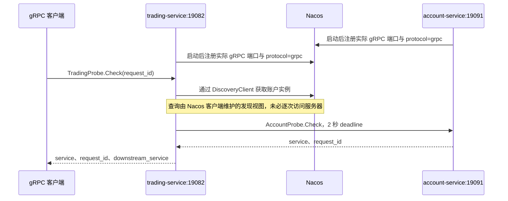

# 架构说明

[返回项目首页](../README.md)

## 模块与职责

| 模块 | 当前职责 | 依赖 |
| --- | --- | --- |
| `ledger-contracts` | 定义版本化 Protobuf 协议，生成 Java 消息和 gRPC stub | Protobuf、gRPC |
| `ledger-platform` | 统一中间件配置、MyBatis-Plus 插件、gRPC 注册与发现工具 | Spring Boot、Spring Cloud 和中间件客户端 |
| `account-service` | 账户服务启动入口和诊断接口 | contracts、platform |
| `trading-service` | 交易服务启动入口，演示调用账户服务 | contracts、platform |
| `ledger-integration-tests` | 同时装载服务并验证框架和真实中间件 | 两个服务的普通 JAR、测试库 |
| `gateway` | 目录占位 | 无，不参与 Maven 构建 |

服务构建时保留普通 JAR，并生成带 `exec` classifier 的可执行 JAR。前者供集成测试引用，运行服务使用 `*-exec.jar`。

## 当前调用链



两个服务都使用 `web-application-type: none`。`GrpcDiscoveryConfiguration` 监听 gRPC 启动事件，取得实际监听端口后触发 Nacos 注册，不依赖 HTTP WebServer 启动事件。平台引入 `spring-boot-web-server` 是为了提供 Spring Cloud 注册基类引用的事件类型，不会因此启动 HTTP 服务器。

`DiscoveryGrpcChannels` 每次选择实例时过滤 `protocol=grpc` 元数据，按轮询选择实例，并按地址复用 ManagedChannel。当前不实现自动重试、熔断或失效地址连接的主动淘汰；缓存连接在应用关闭时释放。

## 业务分层与数据归属

新增业务时按以下职责组织包；目前尚未创建的 application/domain 包随业务增加：

```text
com.ledger.account 或 com.ledger.trading
├── interfaces.grpc          # 协议适配、参数转换、gRPC 状态码
├── application              # 用例编排、事务边界
├── domain                   # 业务规则、领域对象、仓储接口
└── infrastructure
    └── persistence
        ├── entity           # MyBatis-Plus 数据库实体
        └── mapper           # @Mapper + BaseMapper
```

账户服务拥有 `account` schema，交易服务拥有 `trading` schema；两者当前共享开发数据库和登录用户。schema 划分是项目约定，当前不是数据库权限隔离。MyBatis 实体需显式标注所属 schema，Flyway 的 default-schema 不会自动改变所有业务 SQL 的 search_path。服务间访问数据通过 gRPC 或后续业务事件，不直接查询对方表。

## 当前实现边界

已具备基础构建、服务启动、配置中心、服务发现、诊断 RPC、数据库迁移、MyBatis-Plus CRUD/分页/乐观锁能力，以及 Redis/Kafka 客户端配置。

目前没有业务表、资金账务、委托状态机、业务消息 topic 或监听器，也没有业务缓存。诊断 `request_id` 只做透传，不是幂等键或完整链路追踪。网关、鉴权、服务间 TLS、资金一致性和业务幂等需要在后续用例中实现。
