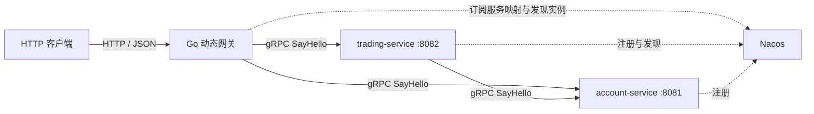

# 架构说明

[返回项目首页](../README.md)

本文描述仓库当前实现。后续领域划分、一致性与运行治理建议见[架构演进路线](roadmap.md)，其中的方案尚未落地。

## 当前架构概览



图中实线表示现有 Hello 请求链，虚线表示注册、发现和网关配置依赖。test/prod 的 Java 服务还从 Nacos 导入运行配置。PostgreSQL、Kafka 和 Redis 当前仅接入客户端配置，未参与 Hello 调用链。

## 模块与职责

| 模块 | 当前职责 | 依赖 |
| --- | --- | --- |
| `ledger-pb` | 定义版本化 Protobuf 协议，生成 Java 消息和 gRPC stub | Protobuf、gRPC |
| `account-service` | 账户服务启动入口、服务自身的中间件配置与 Nacos 注册 | ledger-pb、Spring Boot、Spring Cloud 和中间件客户端 |
| `trading-service` | 交易服务启动入口、可复用的 gRPC 发现客户端及服务自身的基础配置 | ledger-pb、Spring Boot、Spring Cloud 和中间件客户端 |
| `gateway` | Go 动态 HTTP → gRPC 转换、Nacos 发现、路由热更新 | 独立 Go Modules，不参与 Maven 构建 |

服务构建时保留普通 JAR，并生成带 `exec` classifier 的可执行 JAR。运行服务使用 `*-exec.jar`。

`ledger-pb` 是协议依赖库，无需独立部署。两个服务分别声明中间件依赖，`application.yml` 只维护必要启动项、默认 profile 和 Nacos 公共参数。Spring Boot 按 profile 自动加载对应的 `application-{profile}.yml`；未显式启用 profile 时使用 dev。dev 完整使用本地 `application-dev.yml`，Nacos 仅用于注册与发现，配置中心和导入检查均关闭。test/prod 先读取 Nacos 的 `ledger-infrastructure.yml`，再读取自己的服务配置，运行参数参考各服务的 `application-dev.yml`，字段筛选与发布步骤见 [Nacos 配置中心](configuration.md#nacos-配置中心)。环境 namespace 默认分别为 `ledger-dev`、`ledger-test`、`ledger-prod`。根 POM 只统一依赖版本与构建约束，基础配置类位于各服务的 `infrastructure.config`。

## 服务运行与发现

两个服务的 `GrpcVirtualThreadConfiguration` 在 `spring.threads.virtual.enabled=true` 时提供专用虚拟线程执行器，并通过 `GrpcServerExecutorProvider` 接入 gRPC 服务端。每个执行任务使用独立虚拟线程，名称前缀为 `grpc-virtual-`；Spring 关闭上下文时关闭执行器。关闭该开关后恢复 gRPC 默认执行器。该配置控制 RPC 服务回调，Netty 网络 I/O 仍使用事件循环线程。

当前调用链为 HTTP 网关 → TradingService/SayHello → AccountService/SayHello。交易服务通过 Nacos 发现账户服务，用 2 秒 deadline 调用下游并返回服务名称；示例不操作存储。协议目录见 [ledger-pb](../ledger-pb/README.md)。

Java 侧两个服务都使用 `web-application-type: none`。各自的 `GrpcDiscoveryConfiguration` 监听 gRPC 启动事件，通过 `ObjectProvider` 获取 Nacos 注册组件，取得实际监听端口后触发注册；注册组件不存在时跳过处理，不依赖 HTTP WebServer 启动事件。两个服务显式引入 `spring-boot-web-server`，用于提供 Spring Cloud 注册基类引用的事件类型，不会因此启动 HTTP 服务器。Nacos 注册和 MyBatis 插件类都是普通 `@Configuration`，由各服务组件扫描加载，无需自动配置导入清单。

交易服务的 `infrastructure.grpc.DiscoveryGrpcChannels` 每次选择实例时过滤 `protocol=grpc` 元数据，按轮询选择实例，并按地址复用 ManagedChannel。当前不实现自动重试、熔断或失效地址连接的主动淘汰；缓存连接在应用关闭时释放。

## 业务分层与数据归属

新增业务时按以下职责组织包；目前尚未创建的 application/domain 包随业务增加：

```text
com.ledger.account 或 com.ledger.trading
├── interfaces.grpc          # 协议适配、参数转换、gRPC 状态码
├── application              # 用例编排、事务边界
├── domain                   # 业务规则、领域对象、仓储接口
└── infrastructure
    ├── config               # Spring 配置类，包含交易服务的账户客户端装配
    ├── grpc                 # 下游 gRPC 连接与服务发现实现（当前在交易服务）
    └── persistence
        ├── entity           # MyBatis-Plus 数据库实体
        └── mapper           # @Mapper + BaseMapper
```

账户服务拥有 `account` schema，交易服务拥有 `trading` schema；两者当前共享开发数据库和登录用户。schema 划分是项目约定，当前不是数据库权限隔离。schema 通过根目录 `db/` 中的 SQL 手动创建，服务启动时不自动执行脚本。MyBatis 实体需显式标注所属 schema，业务 SQL 使用完整的 schema.table 名称。服务间访问数据通过 gRPC 或后续业务事件，不直接查询对方表。

新增业务的依赖约定：接口层调用 application 用例；application 编排领域规则并声明本地事务；domain 定义规则和仓储接口；infrastructure 实现仓储和外部服务适配。领域代码应保持独立，不依赖 gRPC 消息、MyBatis 实体或中间件客户端。当前 Hello 直接在接口层生成响应或调用下游，业务实现时应按上述职责组织。

## 当前实现边界

已具备基础构建、服务启动、配置中心、服务发现、手动数据库初始化脚本、MyBatis-Plus CRUD/分页/乐观锁能力，以及 Redis/Kafka 客户端配置。

目前没有业务表、资金账务、委托状态机、业务消息 topic 或监听器，也没有业务缓存。当前仅有 Hello 学习接口及交易到账户的示例调用，没有资金或交易业务 RPC。Go 网关已支持动态 unary 调用、Nacos 路由热更新和可选上游 TLS，协议描述可通过反射或本地描述文件加载，详见[网关指南](../gateway/README.md)。完整用户鉴权、资金一致性和业务幂等仍需随业务实现。

## 关键约束与运行边界

| 方面 | 当前行为 | 开发与部署时的含义 |
| --- | --- | --- |
| 事务 | 尚无业务事务；后续 `@Transactional` 仅管理本地数据库操作 | 跨服务 RPC 和 Kafka 发送需要单独的一致性方案 |
| 消息 | 配置了 Kafka 生产者幂等，尚无业务事件 | 仍需设计事件投递、消费去重和失败恢复 |
| 并发 | gRPC 可使用虚拟线程；开发连接池上限为每服务 10 | 线程调度能力不代表数据库或下游容量，业务需设置并发预算 |
| 下游连接 | Java 按地址缓存连接，应用关闭时释放；使用明文连接 | 长期运行需考虑实例变更后的连接清理及内部传输保护 |
| 接口暴露 | 已配置 protobuf service 的全部 unary 方法允许 POST | 内部 RPC 应放入未对外配置的 service；GET 清单需人工确认只读 |
| 身份权限 | 网关可配置固定 Bearer token，并转发有限 metadata | 尚无用户认证、账户归属校验和服务身份体系 |
| 可观测性 | 网关记录请求标识及日志，可转发 trace 上下文 | 尚未接入完整追踪、业务指标和资金审计 |
| 健康检查 | 网关 `/readyz` 检查配置是否加载 | 不能据此判断下游、协议或中间件可用 |
| 数据演进 | SQL 手动执行，无自动迁移历史 | 发布时需独立管理执行顺序、兼容性和执行记录 |
| 验证 | Java 无自动化测试；网关有测试后端 | 构建通过不能证明真实调用链或业务一致性 |

后续能力应通过可复现的故障场景验证，阶段目标见[架构演进路线](roadmap.md)。

## 动态网关的数据流

网关启动时读取独立的 `gateway/config/config.yaml`，配置 HTTP 监听、Nacos、上游 TLS、访问 token 及路由 Data ID。启动 YAML 的字段值支持 `${VAR:默认值}` 和 `${VAR}` 环境变量占位符；仅显式声明占位符的字段读取对应进程环境变量，网关不会自动加载 `.env` 文件。可用 `-config` 指定其他启动配置；配置内相对路径以该文件所在目录为基准。服务发现和远端路由共用 YAML 中的 Nacos namespace/group，需与 Java 服务的注册配置对齐。

启动配置修改后需要重启。服务映射统一从 Nacos 订阅，默认 Data ID 为 `gateway-routes.yml`。本地 `config/routes.example.yml` 使用 `services` 映射声明服务简称、Nacos 服务名、版本对应的 protobuf service、GET 方法清单和超时，不再逐接口配置路由。

HTTP 路径固定为 `/api/{版本}/{服务简称}/{方法名}`。POST JSON 通过 protojson 转换；GET 仅允许清单中的只读方法，Query 仅按 `.proto` 原始字段名自动绑定，嵌套路径逐层严格匹配；POST JSON 继续遵循标准 ProtoJSON 字段命名规则。配置的 protobuf service 中所有 unary 方法允许 POST，因此内部方法需要放到其他 protobuf service。外部请求无法指定任意上游地址或 protobuf service。

配置加载不联系业务服务。首次请求服务版本时，从反射或本地描述文件获取完整协议，构造 dynamicpb 消息并通过复用的 gRPC 连接调用。并发首次访问共享一次最多 5 秒的后台加载，等待者可独立取消；失败不缓存，后续请求可重试。成功协议缓存 1 分钟，过期由下一请求刷新；更新配置 revision 可以立即刷新。Nacos 实例变更独立更新 resolver。

新配置校验通过后整体切换快照，不等待旧请求。每个新快照重新按需建立连接和协议缓存；旧请求和后台协议加载完成后异步关闭旧连接及订阅。无效更新保留旧版本。关闭引擎时停止接入并等待当前及所有旧快照清理。`/readyz` 只代表配置已加载，不检查后端或协议可用性。当前只支持 unary RPC。
